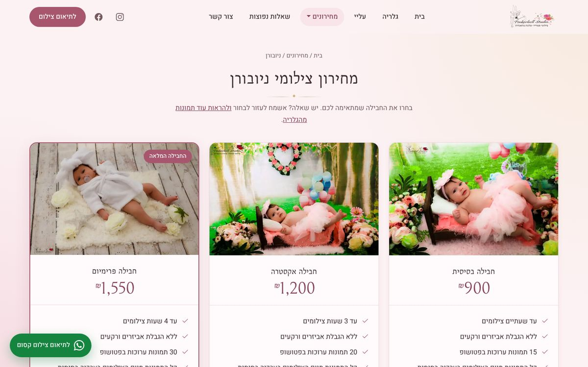

# Tinkerbell Studio ✨

The website of **Tinkerbell Studio** (טינקרבל סטודיו), a boutique photography studio in Modiin, Israel, for newborn, maternity, first-birthday, children and family photo sessions.

The site presents the studio's work, its packages and prices, and makes booking a session one tap away on WhatsApp. It is in Hebrew (right-to-left), designed as a soft "fairy tale" — powder pink, gold touches and a little floating glitter — and everything on it, from the headline to the prices and photos, can be edited by the studio owner from a password-protected admin screen, without touching code.

**Live site:** https://tinkerbell-studio.com
**Admin screen:** https://tinkerbell-studio.com/admin

## Screenshots


<table>
  <tr>
    <td></td>
    <td></td>
    <td></td>
  </tr>
</table>




## What visitors find

| Page | Path | What's on it |
|---|---|---|
| Home | `/` | Hero photo and headline, highlights, the photography types, a short "about", how a session works, testimonials, a trust row (deposit, delivery by Jumbo Mail, feeding breaks) and a call to action |
| About | `/about` | The photographer's story and family photo |
| Gallery | `/gallery` | All photography categories |
| Category gallery | `/imagescreen/<Category>` (e.g. `/imagescreen/NewBorn`) | Masonry grid with a full-screen viewer (arrows, keyboard, swipe on phones) |
| Price lists | `/NewBornPrices`, `/PregnancyPrices`, ... | One page per category: packages, what each includes, extras (canvases, prints) and a WhatsApp "book this package" button |
| FAQ | `/faq` | Common questions, plus a WhatsApp button for anything else |
| Contact | `/contact` | Contact form (EmailJS), phone, WhatsApp, Waze, opening hours and a map |

A floating "לתיאום צילום קסום" WhatsApp button is on every page. Galleries or packages that have no photos yet show a "תמונות חדשות בדרך ✨" card, and packages with no price and no items are hidden.

## What the studio owner can do

The admin screen (`/admin`) covers every page of the site:

- edit any text, price or package, and the FAQ, testimonials and "about" story
- show or hide home page sections, gallery categories and the FAQ page
- upload, replace and reorder photos (several at once, or by dragging them in)
- reorder, add and delete list items
- discard unsaved changes, or restore a page to its built-in content
- change the admin password

Changes appear on the site as soon as they are saved.

## Speed, accessibility and search

- Photos are resized on upload, and phones load 800px thumbnails; the home page's hero photo starts downloading with the page itself.
- Returning visitors see the page immediately from cached content while the latest content loads in the background.
- Every page has its own title, description and canonical link, and a prerendered HTML file, so direct links return status 200; the site also has a `sitemap.xml` and business details (address, hours, phone) for Google.
- Text and buttons keep a readable contrast, and the glitter and animations stop for visitors who prefer reduced motion.

## Tech stack

- **React 18** with Create React App, React Router and React Bootstrap (RTL build)
- **Supabase** (free plan): content database, admin login and photo storage
- **GitHub Pages** for hosting, at the custom domain `tinkerbell-studio.com` (registered at Cloudflare)
- **EmailJS** for the contact form
- Fonts: Bellefair (headings) and Heebo (text), from Google Fonts

## How content works

All texts, prices and photo lists live in JSON documents:

| Document | File | Contents |
|---|---|---|
| `home` | `src/data/components/screens/home.json` | Home page sections and their show/hide switches |
| `about` | `src/data/components/screens/about.json` | The "about" page: story, photo, buttons |
| `faq` | `src/data/components/screens/faq.json` | FAQ questions and answers, and the WhatsApp question button |
| `categories` | `src/data/components/categories.json` | Gallery categories: title, cover, photo list, visibility, order |
| `prices/<name>` | `src/data/components/prices/<name>.json` | Package names, prices, what each package includes, photos |
| `common` | `src/data/components/screens/common.json` | Logo, trust row, "new photos coming" card, extras price tables, shared price-page texts |
| `contact` | `src/data/components/screens/contact.json` | Contact page texts, form labels, studio details |
| `header` | `src/data/components/screens/header.json` | Menu labels |
| `footer` | `src/data/components/screens/footer.json` | Social links, phone, email, floating WhatsApp button |

The JSON files are the defaults built into the site. When the admin saves a document, it is stored in the Supabase `site_content` table and overrides the built-in version. Saved values are merged on top of the defaults, so a field added to a JSON file later still appears even if that document was saved before.

The site loads all saved documents in one request on startup. If Supabase doesn't answer within 3 seconds, it uses the last cached content or the built-in defaults, so the site keeps working.

The admin screen (`src/admin/`) is generated from the JSON documents, so a new field in a JSON file shows up there automatically. Hebrew field names, hidden or locked fields, and templates for lists that can start empty are set in `src/admin/fields.js`.

Adding a new gallery category is not possible from the admin screen yet, because it also needs a price list: it needs a new entry in `categories.json` and a new file in `src/data/components/prices/`.

### Photos

All photos live in the Supabase `site-images` bucket; none are stored in this repository. They are added from the admin screen: each upload is resized in the browser to at most 1920px (JPEG at 82% quality, or PNG for images with transparency), its EXIF data (including GPS) is removed, and it gets an 800px-wide thumbnail at the same path under `thumbs/`. Only the resized version is stored, so keep the originals elsewhere.

The content stores a photo either as a full URL (uploads) or as a path inside the bucket (the built-in content, e.g. `bundled/Gallery/NewBorn/1.jpg`); `src/content/images.js` turns both into addresses.

## Local development

```bash
npm install
npm start
```

The site opens at http://localhost:3000.

Without a `.env` file the site runs on the built-in JSON content, without photos, and the admin screen is disabled. To connect it to Supabase, copy `.env.example` to `.env` and fill in:

```
REACT_APP_SUPABASE_URL=https://<project>.supabase.co
REACT_APP_SUPABASE_ANON_KEY=<publishable or anon key>
```

Both values are public by design: they end up in the site's JavaScript, and what they allow is limited by the database policies. **Never put the secret / `service_role` key in `.env`**, and never commit `.env` (it is git-ignored).

## Scripts

| Command | What it does |
|---|---|
| `npm start` | Runs the site locally |
| `npm test` | Runs the tests (admin editor, content loading) |
| `npm run build` | Builds the production site into `build/` |
| `npm run deploy` | Builds, prerenders and publishes to GitHub Pages (the `gh-pages` branch) |

## Deployment

```bash
npm run deploy
```

This builds the site, runs `scripts/prerender-routes.js` and pushes `build/` to the `gh-pages` branch. The prerender step writes an HTML file for every page (e.g. `gallery.html`, served at `/gallery`) with its own title, description and canonical link, writes `sitemap.xml`, and copies the page to `404.html` for any other address. GitHub Pages must be set to deploy from that branch (repository Settings → Pages).

The Supabase values must be available when deploying, otherwise the published site won't connect to Supabase: either a local `.env` file or the `REACT_APP_SUPABASE_URL` and `REACT_APP_SUPABASE_ANON_KEY` environment variables, which the build reads the same way.

The domain is set by `homepage` in `package.json` and by `public/CNAME`. All internal links use `process.env.PUBLIC_URL`, so changing `homepage` is enough to move the site.

## Supabase setup

For a new Supabase project:

1. Create a project (a European region is closest to Israel).
2. In the **SQL Editor**, run `supabase/schema.sql`. It creates the `site_content` and `admins` tables, the access policies and the `site-images` bucket. It is safe to run again.
3. Under **Authentication → Sign In / Providers**, turn off **Allow new users to sign up**.
4. Under **Authentication → Users**, add the admin user.
5. Make that user an admin in the SQL Editor:
   ```sql
   insert into public.admins (user_id)
   select id from auth.users where email = 'admin@example.com';
   ```
6. Copy the project URL and the publishable key into `.env`.

### Security

- Anyone can read the content and view the photos.
- Only users listed in the `admins` table can save content or upload photos. This is enforced by Row Level Security in the database, not by the site's code.
- Signing up is disabled, so new users can only be created from the Supabase dashboard.

### Keeping the free project awake

Free Supabase projects pause after a week without activity, and the whole site depends on it for its content and photos. The GitHub workflow `.github/workflows/supabase-keepalive.yml` reads the content once a day to prevent this. It needs two repository variables (Settings → Secrets and variables → Actions → Variables): `SUPABASE_URL` and `SUPABASE_ANON_KEY`, with the same values as in `.env`.

Since all photos are served from Supabase, keep an eye on the plan's monthly bandwidth in the Supabase dashboard.

### Admin password

- **Known password:** log in and use **שינוי סיסמה** (change password) in the top bar.
- **Forgotten password:** run this in the Supabase SQL Editor, then delete the query from the editor:
  ```sql
  update auth.users
  set encrypted_password = extensions.crypt('new-password', extensions.gen_salt('bf'))
  where email = 'admin@example.com';
  ```

## Project structure

```
public/                 index.html, app icons, CNAME, robots.txt (no photos)
docs/screenshots/       Screenshots for this README (not used by the site)
scripts/                prerender-routes.js (runs before deploy)
supabase/schema.sql     Database tables, policies and storage bucket
src/
  App.js                Routes (price pages are generated from the categories)
  content/              Loading content from Supabase, defaults, photo addresses
  admin/                Admin screen, form editor, photo upload, password change
  data/components/      Built-in content (JSON)
  data/                 Category helpers, WhatsApp links, page descriptions (seo.json)
  screens/              Home, about, gallery, category gallery, FAQ, contact, 404
  components/           Header, footer, price page, lightbox, testimonials, trust row, ...
  hooks/                Page title and description
.github/workflows/      Supabase keep-awake job
```
